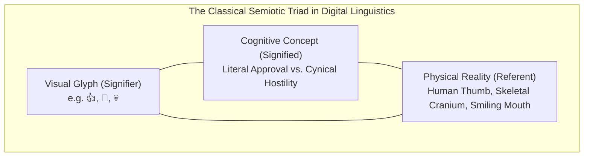
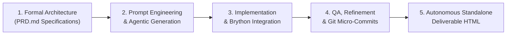

# 🎭 The Secret Language of Emojis
### *Generational Semiotics, Digital Kinesics & Interactive Web Arcade*

[](https://www.biu.ac.il/)
[](https://www.biu.ac.il/)
[](https://www.biu.ac.il/)
[](https://threejs.org/)
[](LICENSE)

---

## 📌 Executive Summary & Academic Context

**The Secret Language of Emojis** is an interactive, standalone web-based presentation deck and research showcase developed as a capstone project for the **Generative AI & Agents** course at **Bar-Ilan University**, instructed by **Dr. Yoram Segal**.

This project investigates the evolution of digital glyphs from utilitarian 12×12 pixel communication aids in late-1990s Tokyo into a complex, polysemous cryptographic dialect. By bridging academic semiotic theory with state-of-the-art interactive front-end engineering, the project translates sociolinguistic phenomena into an exploratory digital experience. The entire system—encompassing 3D WebGL rendering, Web Audio synthesis, interactive arcade mechanics, and behind-the-scenes client-side Python data processing—is packaged into a zero-dependency, self-contained single-file HTML deliverable: [`emoji_presentation.html`](file:///C:/biu01/01/emoji_presentation.html).

```
   ┌────────────────────────────────────────────────────────────────────────┐
   │                    THE SECRET LANGUAGE OF EMOJIS                       │
   │  Academic Capstone Deck: Generational Semiotics & Interactive Arcade   │
   ├──────────────────────────────────┬─────────────────────────────────────┤
   │ 🏛️ Institution: Bar-Ilan Univ.    │ 👨‍🏫 Lecturer: Dr. Yoram Segal       │
   │ 🤖 Course: GenAI & Agents        │ 📦 Artifact: emoji_presentation.html│
   └──────────────────────────────────┴─────────────────────────────────────┘
```

---

## 📑 Table of Contents

- [1. Project Overview & Core Vision](#1-project-overview--core-vision)
  - [1.1 Semiotic Framework & Semiotic Drift](#11-semiotic-framework--semiotic-drift)
  - [1.2 Generational Polarity: Gen X vs. Gen Z](#12-generational-polarity-gen-x-vs-gen-z)
  - [1.3 Real-World Sociolinguistic & Legal Implications](#13-real-world-sociolinguistic--legal-implications)
- [2. Technical Architecture & Layered Design](#2-technical-architecture--layered-design)
  - [2.1 Layer 1: Structural Semantics & DOM Hierarchy (HTML5)](#21-layer-1-structural-semantics--dom-hierarchy-html5)
  - [2.2 Layer 2: Cyberpunk Glassmorphic Design System (CSS3)](#22-layer-2-cyberpunk-glassmorphic-design-system-css3)
  - [2.3 Layer 3: Interactive State Machines & 3D WebGL Graphics (JavaScript & Three.js)](#23-layer-3-interactive-state-machines--3d-webgl-graphics-javascript--threejs)
  - [2.4 Embedded Python Engine via Brython](#24-embedded-python-engine-via-brython)
- [3. Interactive Features & Slide-by-Slide Breakdown](#3-interactive-features--slide-by-slide-breakdown)
  - [Slide 1: Title & Hero Stage (3D Emoji Double Helix)](#slide-1-title--hero-stage-3d-emoji-double-helix)
  - [Slide 2: Generational Emoji Dictionary](#slide-2-generational-emoji-dictionary)
  - [Slide 3: Memory Match Mini-Game](#slide-3-memory-match-mini-game)
  - [Slide 4: Popular Emoji Analytics & Quantitative Semiotics](#slide-4-popular-emoji-analytics--quantitative-semiotics)
  - [Slide 5: Emoji Wordle](#slide-5-emoji-wordle)
  - [Slide 6: Guess the Country by Emoji Triad (Decoder)](#slide-6-guess-the-country-by-emoji-triad-decoder)
  - [Slide 7: Interactive Emoji Roulette](#slide-7-interactive-emoji-roulette)
  - [Slide 8: Generational Trivia Challenge](#slide-8-generational-trivia-challenge)
  - [Slide 9: Historical Evolution & Media Archaeology](#slide-9-historical-evolution--media-archaeology)
  - [Slide 10: "Catch the Emoji" 60 FPS Arcade Mini-Game](#slide-10-catch-the-emoji-60-fps-arcade-mini-game)
  - [Slide 11: Presentation Finale & Academic Synthesis](#slide-11-presentation-finale--academic-synthesis)
- [4. Visuals & Screenshots Showcase](#4-visuals--screenshots-showcase)
- [5. Setup & Execution Instructions](#5-setup--execution-instructions)
  - [5.1 Direct Browser Execution (Zero-Install)](#51-direct-browser-execution-zero-install)
  - [5.2 Local HTTP Server (Optional)](#52-local-http-server-optional)
  - [5.3 Comprehensive Keyboard Navigation Controls](#53-comprehensive-keyboard-navigation-controls)
- [6. Engineering Workflow & Agentic Methodology](#6-engineering-workflow--agentic-methodology)
  - [6.1 Specification-Driven Development (`PRD.md`)](#61-specification-driven-development-prdmd)
  - [6.2 Prompt Engineering & Multi-Stage Chaining](#62-prompt-engineering--multi-stage-chaining)
  - [6.3 Iterative Git Commit Strategy](#63-iterative-git-commit-strategy)
- [7. Project Directory Structure](#7-project-directory-structure)
- [8. Academic References & Attributions](#8-academic-references--attributions)

---

## 1. Project Overview & Core Vision

### 1.1 Semiotic Framework & Semiotic Drift

At the heart of this research is the classical semiotic triad formalized by **Charles Sanders Peirce** and **Ferdinand de Saussure**:



In traditional typography, characters possess stable, codified semantic values. In contrast, emojis undergo rapid **Semiotic Drift**—a sociolinguistic phenomenon whereby the cultural connotation (*signified*) diverges radically from its pictorial root (*signifier*). While older generations maintain an indexical, literal interpretation, younger internet-native cohorts assign inverted, ironic, or defensive subtexts to identical Unicode code points.

### 1.2 Generational Polarity: Gen X vs. Gen Z

The project demonstrates this cognitive divergence through empirical comparisons across four generational cohorts, focusing primarily on the sharpest ideological tension: **Generation X (Pragmatic Literalism)** versus **Generation Z (Post-Ironic Subversion)**.

| Glyph | Unicode Name | Gen X / Pragmatic Interpretation | Gen Z / Subversive Interpretation | Sociolinguistic Mechanism |
| :---: | :--- | :--- | :--- | :--- |
| **👍** | Thumbs Up | "Affirmative; acknowledged; task approved." | "Contemptuous dismissal; hostile silence; passive-aggression." | **Pragmatic Deflation:** Extreme brevity perceived as emotional withdrawal. |
| **🙂** | Slightly Smiling Face | "Polite pleasantry; amicable disposition." | "Masked rage; internal dread; performative compliance." | **Affective Masking:** Static unblinking smile mirrors fake corporate optimism. |
| **💀** | Skull | "Physical death; danger; morbidity; hazard." | "Extreme laughter; hilarity; 'I am dying of laughter'." | **Hyperbolic Metaphor:** Substitution of physiological joy with metaphorical demise. |
| **🧢** | Billed Cap | "Headwear; sports apparel; sun protection." | "Deception; falsehood; 'stop lying' ('no cap' = truth)." | **African American Vernacular English (AAVE)** crossover into algorithmic vernacular. |
| **🤡** | Clown Face | "Circus performer; childhood entertainment." | "Public fool; self-sabotaging behavior; foolish delusion." | **Performative Satire:** Diagnosing irrational cognitive dissonance in others. |
| **💅** | Nail Polish | "Cosmetics; manicure; self-care." | "Effortless triumph; mic drop; unbothered superiority." | **Kinesic Embodiment:** Nonchalant gesture signaling emotional unreachability. |
| **🫠** | Melting Face | "Heat stroke; warm weather; liquefaction." | "Smiling through existential crisis; silent dissociation." | **Existential Irony:** Retaining social composure while psychically dissolving. |
| **☕** | Hot Beverage | "Coffee break; hot tea; relaxation." | "Sexist gossip commentary; 'women ☕' meme trope." | **Subcultural Irony:** Internet meme shorthand denoting predictable folly. |

### 1.3 Real-World Sociolinguistic & Legal Implications

Emoji ambiguity is no longer merely an informal quirk of instant messaging; it now represents a multi-million-dollar legal and organizational liability:
- **Judicial Contract Law Precedent:** In *South West Terminal Ltd. v. Achter Land & Cattle Ltd.* (2023 SKKB 116), the Saskatchewan Court of King's Bench ruled that a vendor's single **👍** emoji in response to an unsigned grain sales contract constituted a legally binding electronic signature, assessing **$82,000 CAD** in damages for breach of contract.
- **Enterprise Communication Friction:** Quantitative surveys indicate that over **84%** of remote and hybrid enterprise employees experience communicative friction due to divergent emoji tone protocols between senior leadership (Boomer/Gen X) and junior contributors (Gen Z).

---

## 2. Technical Architecture & Layered Design

The technical design follows a strict **Three-Layer Architecture** complemented by an embedded **Python-via-Brython** statistical backend. The entire deliverable is packaged into an ultra-clean, zero-dependency, self-contained single-file HTML document (`emoji_presentation.html`).

```mermaid
graph TD
    subgraph SingleFileHTML ["emoji_presentation.html (Single-File Architecture)"]
        subgraph Layer1 ["Layer 1: Structural DOM & Semantics (HTML5)"]
            DOM["Semantic Section Hierarchy\n11 Slides with data-index & data-title"]
            ARIA["ARIA Accessibility Tags, Modal Dialogs & HUD Containers"]
        end
        
        subgraph Layer2 ["Layer 2: Visual Styling & Design System (CSS3)"]
            Neon["Dark Cyberpunk Color Tokens\nCyan, Neon Pink, Acid Green, Amber"]
            Glass["Backdrop Glassmorphism\nbackdrop-filter: blur(24px)"]
            Anim["3D Perspective Transforms & CSS Keyframe Accelerations"]
        end
        
        subgraph Layer3 ["Layer 3: Interactivity, Audio & 3D (Vanilla JS + Three.js r128)"]
            Engine["Slide Navigation State Machine & Keyboard Listener"]
            ThreeParticles["Ambient Particle Background Field (240 Particles)"]
            ThreeHelix["Slide 1 Hero 3D Double-Helix with Dynamic Gaze Tracking"]
            WebAudio["Synthesized Procedural Web Audio API (Zero Audio Files)"]
            CanvasEngines["HTML5 Canvas Engines: Roulette Decelerator & 60 FPS Arcade"]
        end
        
        subgraph PythonLayer ["Behind-the-Scenes Python Engine (Brython 3.12)"]
            DataModel["EmojiDataProcessor: Global vs Gen Z Distribution Matrix"]
            TriviaEngine["CountryTriviaEngine: Stateful 30-Nation Geographic Pool"]
            Bridge["window.PythonBridge (Two-Way JS-Python Interop)"]
        end
    end
    
    Layer1 --> Layer2
    Layer2 --> Layer3
    PythonLayer -->|Data Bridge| Layer3
```



### 2.1 Layer 1: Structural Semantics & DOM Hierarchy (HTML5)
- **Strict Directionality:** Enforces `dir="ltr"` and `lang="en"` for international academic consistency.
- **Slide Stage Model:** Uses standard `<main id="presentation-viewport">` with sequential `<section class="slide" data-index="N" data-title="...">` tags.
- **Micro-Layouts:** Semantic `<header>`, `<footer>`, `<aside class="roulette-stage-box">`, `<div class="hud-panel">`, and native `<canvas>` staging.
- **Zero External File Bindings:** Contains all styling, layouts, procedural audio synthesis, 3D math, and Python logic without requiring external `.css`, `.js`, or media files.

### 2.2 Layer 2: Cyberpunk Glassmorphic Design System (CSS3)
- **Dark Mode Cyberpunk Aesthetics:** Built upon an obsidian baseline (`#090d16` and `#0d111a`).
- **Luminescent Accent Palette:**
  - Electric Cyan (`#00F0FF`): Primary interactive anchors and 3D lighting.
  - Neon Magenta (`#FF007A`): Gen Z subversive signifiers and hazard alerts.
  - Acid Lime (`#39FF14`): Empirical validation, streaks, and correct states.
  - Cyber Amber (`#FFE600`): Historical timelines and caution warnings.
- **Ultra-Fine Glassmorphism:** Implements `backdrop-filter: blur(24px)` combined with layered translucent borders (`rgba(255, 255, 255, 0.08)`) and radial rim glows.
- **Typography:** Google Fonts integration featuring `Plus Jakarta Sans` for editorial elegance and `JetBrains Mono` for telemetry, scores, and code badges.
- **Hardware-Accelerated 3D Transforms:** Employs `transform-style: preserve-3d`, `perspective(1000px)`, and `will-change` hints for smooth 60 FPS transitions.

### 2.3 Layer 3: Interactive State Machines & 3D WebGL Graphics (JavaScript & Three.js)
- **Slide Presentation Controller:** Deterministic state machine supporting keyboard routing, circular progress tracking, dot indicators, and full-screen toggling.
- **Ambient WebGL Background Particle Field:**
  - Uses Three.js (r128) to render 240 high-efficiency floating particles with additive blending (`THREE.AdditiveBlending`).
  - Dynamic scene lighting shifts color dynamically based on the current slide's thematic palette via smooth linear interpolation (`color.lerp`).
- **Hero 3D Double-Helix Emoji Chain (Slide 1):**
  - **Catmull-Rom Helical Spline:** Computes a continuous mathematical 3D double helix curve (`THREE.CatmullRomCurve3`) extruded via `THREE.TubeGeometry` across 2 full helical revolutions ($4\pi$ radians).
  - **Procedural Emoji Nodes:** 10 procedural 3D emoji heads (Smile, Sunglasses, Heart Eyes, Laughing, Winking, Skull, Star Eyes, Cheeky, Angel, Pleased) mounted to the glowing spine with golden metallic collars (`THREE.TorusGeometry`).
  - **Real-Time Cursor Gaze Tracking:** Continuous normalized mouse coordinate tracking calculating vector differentials, steering eye assemblies and pupil meshes (`currentGazeX/Y` with inertial dampening) to look directly at the viewer's pointer.
  - **Dual Interaction Modes:** Continuous autonomous 360° turntable Y-axis rotation combined with interactive pointer drag-orbiting.
- **Procedural Web Audio API Synthesizer:**
  - Zero external `.mp3` or `.wav` dependencies.
  - Mathematically generates pure wave audio:
    - `click`: 800Hz–400Hz frequency modulation (`sine`, 40ms decay).
    - `whoosh`: Low-pass filtered noise band (`triangle`, 300ms pitch drop).
    - `chime`: 3-note harmonic arpeggio (C6, E6, G6).
    - `bomb`: 90Hz sawtooth wave decaying to 30Hz with dual-gain saturation.
    - `flip`: 520Hz short percussive blip.
  - Includes global mute toggling (`M` key).

### 2.4 Embedded Python Engine via Brython

While modern front-ends rely heavily on JavaScript, this project showcases client-side **Python 3 execution** directly inside the browser using [Brython](https://brython.info/) (v3.12.0) via an embedded script (`<script type="text/python" id="python-backend">`).

```python
# Conceptual snippet from the embedded Python backend
class EmojiDataProcessor:
    """Processes global emoji distribution models and calculates generational variances."""
    def __init__(self):
        self.stats = [
            {"glyph": "😂", "name": "Tears of Joy", "global": 10.2, "genz": 2.4, "workplace": 5.8},
            {"glyph": "💀", "name": "Skull (Laughter)", "global": 3.9, "genz": 11.4, "workplace": 0.8},
            # ... additional empirical metrics
        ]

    def get_stats_for_category(self, cat):
        return sorted(self.stats, key=lambda x: x.get(cat, x["global"]), reverse=True)

class CountryTriviaEngine:
    """Stateful non-repeating geographic puzzle selection across 30 nations."""
    def __init__(self):
        self.pool = [...] # 30 countries categorized by Easy, Medium, Hard
        self.used = []

    def get_random_country(self):
        available = [c for c in self.pool if c["name"] not in self.used]
        if not available:
            self.used = []
            available = self.pool
        chosen = random.choice(available)
        self.used.append(chosen["name"])
        return chosen

# Bridge objects directly onto the browser window object
window.PythonBridge = {
    "getStats": lambda cat: py_processor.get_stats_for_category(cat),
    "getCountry": lambda: py_country_engine.get_random_country()
}
```

- **Seamless JavaScript Interoperability:** JavaScript checks `window.PythonBridge` first; if Brython is initializing, a native JavaScript fallback gracefully handles computation, ensuring zero downtime.
- **Pure Client-Side Computation:** Executes directly on the user's CPU without sending telemetry or requiring an active Python server runtime.

---

## 3. Interactive Features & Slide-by-Slide Breakdown

```
 ┌──────┐ ┌──────┐ ┌──────┐ ┌──────┐ ┌──────┐ ┌──────┐ ┌──────┐ ┌──────┐ ┌──────┐ ┌──────┐ ┌──────┐
 │Slide1│>│Slide2│>│Slide3│>│Slide4│>│Slide5│>│Slide6│>│Slide7│>│Slide8│>│Slide9│>│Sld10 │>│Sld11 │
 │ 3D   │ │Dict. │ │Memory│ │Data  │ │Wordle│ │Country││Roulet││Trivia│ │Hist. │ │Arcade│ │Thank │
 │Helix │ │Cards │ │Match │ │Charts│ │5-Ltr │ │Decoder││Wheel ││Quiz  │ │1999+ │ │Catch │ │ You  │
 └──────┘ └──────┘ └──────┘ └──────┘ └──────┘ └──────┘ └──────┘ └──────┘ └──────┘ └──────┘ └──────┘
```

The presentation consists of **11 cohesive, highly interactive slides**:

### Slide 1: Title & Hero Stage (3D Emoji Double Helix)
- **Pedagogical Objective:** Introduce the research domain of cultural semiotics and digital kinesics.
- **Hero Metrics Display:** Visual HUD highlighting **10B+ daily emoji volume**, **84% workplace friction rate**, and **4 distinct generational syntax models**.
- **Interactive 3D Three.js Double Helix:**
  - 10 procedurally shaded emoji avatars organized along a mathematical double helix.
  - Interactive gaze tracking: emoji eyes smoothly steer toward the user's cursor.
  - Manual touch/mouse orbit drag controls with continuous turntable Y-axis rotation.

### Slide 2: Generational Emoji Dictionary
- **Pedagogical Objective:** Contrast literal indexical meaning against subversive post-ironic subtexts.
- **Interactive Component:** Responsive 8-card interactive grid comparing 👍, 🙂, 💀, 🧢, 🤡, 💅, 🫠, and ☕.
- **Features:** 
  - Dynamic filtering tabs: *All Emojis*, *Workplace Hazards*, *Youth Inversion*, *Sass & Praise*.
  - Real-time live search filter.
  - Clickable modal dialog displaying comprehensive cultural lore, etymology, and generational usage examples.

### Slide 3: Memory Match Mini-Game
- **Pedagogical Objective:** Gamify the cognitive mapping between emojis and their generational subcultural meanings.
- **Game Mechanics:** 12 cards (6 matched pairs) rendered in 3D with realistic CSS card-flip physics.
- **Pairings:** 
  - 💀 ↔ *"Dying of Laughter"*
  - 🧢 ↔ *"Calling Out a Lie"*
  - 👍 ↔ *"Dismissive Hostility"*
  - 🤡 ↔ *"Acting Foolish"*
  - 💅 ↔ *"Sassy Mic Drop"*
  - 🫠 ↔ *"Smiling Through Dread"*
- **HUD Telemetry:** Live moves counter, elapsed stopwatch timer, pair matches indicator, victory fanfare, and replay button.

### Slide 4: Popular Emoji Analytics & Quantitative Semiotics
- **Pedagogical Objective:** Present empirical corpus linguistics data on emoji transmission shares and generational variance.
- **Data Visualizations:** Clean CSS horizontal bar charts dynamically animating global transmission frequencies:
  - 😂 Tears of Joy (10.2%)
  - ❤️ Red Heart (8.4%)
  - 🤣 Rolling Laughter (6.8%)
  - 👍 Thumbs Up (5.4%)
  - 😭 Loudly Crying (4.9%)
  - 🙏 Folded Hands (4.1%)
  - 💀 Skull (3.9%)
  - 🥰 Smiling with Hearts (3.5%)
- **Data Slicing:** Switch between *All-Time Global*, *Gen Z Peak*, and *Workplace Slack*.
- **Theoretical Synthesis:** Annotation breaking down the **Semiotic Inflation Law** and the Canadian court precedent.

### Slide 5: Emoji Wordle
- **Pedagogical Objective:** Test linguistic decoding by guessing emoji names from purely conceptual, academic clues rather than visual images.
- **Game Mechanics:**
  - 6 attempts to guess a secret 5-letter emoji keyword (e.g., `SKULL`, `CLOWN`, `HEART`).
  - Dual input routing: interactive on-screen virtual QWERTY keyboard and physical desktop keyboard.
  - Color-coded feedback: 🟩 Green (Correct letter & position), 🟨 Yellow (Present in word, incorrect position), ⬛ Dark Slate (Absent).
  - Fluid 3D flip card animations and procedural victory/defeat chimes.

### Slide 6: Guess the Country by Emoji Triad (Decoder)
- **Pedagogical Objective:** Explore national semiotics and cross-cultural iconography.
- **Game Mechanics:**
  - The system displays a 3-glyph triad symbolizing a sovereign nation (e.g., 🗼 🥖 🍷 for France, 🍣 🗻 🗾 for Japan, 🦘 🐨 🏉 for Australia).
  - Powered by Brython's `CountryTriviaEngine` across a 30-nation database categorized into Easy, Medium, and Hard tiers.
  - Text input with automatic alias tolerance (e.g., accepting "USA", "America", or "United States").
  - Dynamic streak tracking, skip options, and progressive hint disclosures (continent and capital city).

### Slide 7: Interactive Emoji Roulette
- **Pedagogical Objective:** Demystify accidental workplace miscommunications via randomized probabilistic decoding.
- **Interactive Component:** Custom HTML5 Canvas spinning roulette wheel featuring 12 iconic cultural glyphs, neon outer rim, and 24 animated LED perimeter bulbs.
- **Physics & Audio Engine:** Realistic physics deceleration via quartic ease-out curve (`easeOutQuart`) and procedural audio tick sounds on sector crossings.
- **Result Stage:** Renders an in-depth semiotic card breaking down the selected glyph across Boomers, Gen X, Millennials, and Gen Z, alongside workplace hazard ratings and contextual usage examples.

### Slide 8: Generational Trivia Challenge
- **Pedagogical Objective:** Assess mastery of digital sociolinguistics, workplace Slack etiquette, Unicode history, and Canadian jurisprudence.
- **Quiz System:** 6 randomized multiple-choice questions with real-time answer verification.
- **Scoring & Evaluation:** Real-time streak multiplier (+25 bonus points per consecutive correct answer), visual green/red feedback cards, comprehensive academic rationales, and final rank badge classification.

### Slide 9: Historical Evolution & Media Archaeology
- **Pedagogical Objective:** Trace the historical trajectory of digital pictograms across key technological milestones:
  1. *1999 (Tokyo Genesis):* Shigetaka Kurita crafts 176 12×12 pixel pictograms for NTT DoCoMo's i-mode pager service.
  2. *2010 (Universal Standardization):* Unicode 6.0 officially integrates 722 emojis as standardized computing characters.
  3. *2011–2015 (Mobile Proliferation):* Native iOS and Android keyboards launch; Oxford Dictionaries names 😂 "Word of the Year" (2015).
  4. *2016–Present (High Culture & Jurisprudence):* MoMA acquires original NTT DoCoMo sketches for its permanent design collection; emojis achieve evidentiary standing in global courtrooms.
- **Interactive Feature:** "Toggle 12px Pixel View" demo rendering retro high-contrast pixelation.

### Slide 10: "Catch the Emoji" 60 FPS Arcade Mini-Game
- **Pedagogical Objective:** Provide an adrenaline-fueled kinetic palate cleanser that rewards fast visual emoji discrimination.
- **Game Loop:** Real-time 60 FPS arcade canvas engine driven by `requestAnimationFrame`.
- **Glyph Scoring Matrix:**
  - 💖 Sparkling Pink Heart: +30 Points
  - ⭐ Golden Star: +20 Points
  - 💀 Gen Z Laughing Skull: +15 Points
  - 😂 Joy Face: +10 Points
  - 🔥 Fire Glyph: +25 Points
- **Hazard Mechanics:** 💣 Bombs trigger a stage screen shake, dock 50 points, reset combo multipliers, and cost 1 life.
- **HUD Systems:** 30-second countdown clock, 3-heart health system, floating point text popups at click coordinates, and local high-score persistence.

### Slide 11: Presentation Finale & Academic Synthesis
- **Pedagogical Objective:** Synthesize core takeaways regarding empathy in cross-generational digital communication.
- **Visual Design:** Glassmorphic frosted summary card framed by animated floating celebration emojis (🙏, 💖, ✨, 🚀, 🎭, 🌟) and radiant pulsating hearts.
- **Navigation Controls:** Instant restart button returning to Slide 1 and dedicated jump shortcuts to any mini-game stage.

---

## 4. Visuals & Screenshots Showcase

To provide a preview of the presentation's visual polish, screenshots are organized below:

### 3D Three.js Emoji Helix & Interactive Gaze Tracking (Slide 1)
```
  ┌─────────────────────────────────────────────────────────────┐
  │  CULTURAL SEMIOTICS & DIGITAL KINESICS                      │
  │  THE SECRET LANGUAGE OF EMOJIS                              │
  │                                     ╭────────────────────╮  │
  │   [ 10B+ DAILY ]                   │    (◕‿◕)  (•‿•)     │  │
  │   [ 84% FRICTION ]                 │       \  /          │  │
  │   [ 4 SYNTAXES ]                   │     (🕶️) (💀)       │  │
  │                                    │        \/  Helix    │  │
  │   > Explore Generational Semiotics │     (❤️) (⭐)       │  │
  │   > Test Interactive Arcade        │        /\           │  │
  │                                    ╰────────────────────╯  │
  └─────────────────────────────────────────────────────────────┘
```
> *Placeholder path:* `docs/screenshots/hero_3d_helix.png`  
> *Illustration:* The Three.js WebGL canvas running on Slide 1, depicting the glowing cyan Catmull-Rom spline helix with 10 procedurally rendered emoji heads dynamically tracking the cursor position.

---

### Generational Dictionary & Comparative Semiotics (Slide 2)
```
  ┌─────────────────────────────────────────────────────────────┐
  │  GENERATIONAL EMOJI DICTIONARY                              │
  │  [ Filter: All | Workplace Hazards | Youth Inversion ]      │
  │                                                             │
  │  ┌──────────────┐ ┌──────────────┐ ┌──────────────┐        │
  │  │  👍 THUMBS UP │ │  🙂 SMILE    │ │  💀 SKULL    │        │
  │  ├──────────────┤ ├──────────────┤ ├──────────────┤        │
  │  │ Gen X: Agree │ │ Gen X: Polite│ │ Gen X: Danger │        │
  │  │ Gen Z: Hostile│ │ Gen Z: Rage  │ │ Gen Z: Dying 🤣│      │
  │  └──────────────┘ └──────────────┘ └──────────────┘        │
  └─────────────────────────────────────────────────────────────┘
```
> *Placeholder path:* `docs/screenshots/emoji_dictionary.png`  
> *Illustration:* Glassmorphic cards contrasting Gen X pragmatic literalism with Gen Z post-ironic subversion, complete with instant category filters and search bar.

---

### Interactive Mini-Games: Wordle, Country Triad Decoder & Roulette (Slides 5, 6, 7)
```
  ┌───────────────────────┐ ┌───────────────────────┐ ┌───────────────────────┐
  │     EMOJI WORDLE      │ │ COUNTRY TRIAD DECODER │ │    EMOJI ROULETTE     │
  │  Clue: "Morbid glyph  │ │  Icons: 🗼 🥖 🍷      │ │       ╭───────╮       │
  │  meaning Gen Z laugh" │ │                       │ │      │   🎯   │       │
  │  [S][K][U][L][L] 🟩🟩 │ │  Input: [ France    ] │ │       ╰───────╯       │
  │  [ Virtual Keyboard ] │ │  Streak: 🔥 5  Hint?  │ │  [ 🎰 Spin Roulette ] │
  └───────────────────────┘ └───────────────────────┘ └───────────────────────┘
```
> *Placeholder paths:* 
> - `docs/screenshots/emoji_wordle.png`
> - `docs/screenshots/country_decoder.png`
> - `docs/screenshots/emoji_roulette.png`  
> *Illustration:* The three custom puzzle stages highlighting dual keyboard input, Brython-powered country generation, and canvas physics deceleration.

---

### "Catch the Emoji" 60 FPS Arcade Arena (Slide 10)
```
  ┌─────────────────────────────────────────────────────────────┐
  │  [ ❤️ ❤️ ❤️ ]      SCORE: 485      TIMER: 00:18    BEST: 620 │
  │                                                             │
  │            💖 (+30)                 🔥 (+25)                │
  │                                                             │
  │                    💣 [-50 BOMB!]                           │
  │                                                             │
  │     ⭐ (+20)                               😂 (+10)         │
  └─────────────────────────────────────────────────────────────┘
```
> *Placeholder path:* `docs/screenshots/arcade_minigame.png`  
> *Illustration:* Smooth 60 FPS canvas displaying floating emojis, hazard bombs, floating score pings, and real-time combo multipliers.

---

## 5. Setup & Execution Instructions

### 5.1 Direct Browser Execution (Zero-Install)

This project has been engineered to be **100% self-contained**. No Node.js runtime, build toolchains (Vite, Webpack), or package manager installations are required.

1. **Clone or Download the Repository:**
   ```bash
   git clone https://github.com/hilaabay123-droid/emoji_presentation.git
   cd emoji_presentation
   ```
2. **Launch Directly in Your Browser:**
   - **Windows:** Double-click [`emoji_presentation.html`](file:///C:/biu01/01/emoji_presentation.html) or run in PowerShell:
     ```powershell
     Start-Process "emoji_presentation.html"
     ```
   - **macOS:**
     ```bash
     open emoji_presentation.html
     ```
   - **Linux:**
     ```bash
     xdg-open emoji_presentation.html
     ```
3. Compatible with all modern desktop and mobile browsers supporting WebGL and ES6 (Google Chrome, Microsoft Edge, Mozilla Firefox, Apple Safari, Brave, Opera).

### 5.2 Local HTTP Server (Optional)

If preferred for local development or remote device testing, spin up a lightweight local server:

- **Using Python 3:**
  ```bash
  python -m http.server 8000
  # Open http://localhost:8000/emoji_presentation.html
  ```
- **Using Node.js (`npx serve`):**
  ```bash
  npx serve .
  ```
- **Using VS Code:** Right-click [`emoji_presentation.html`](file:///C:/biu01/01/emoji_presentation.html) and select **"Open with Live Server"**.

### 5.3 Comprehensive Keyboard Navigation Controls

The deck features full hardware keyboard event routing:

| Keybinding | Action Triggered | Context |
| :--- | :--- | :--- |
| <kbd>→</kbd> / <kbd>Space</kbd> / <kbd>Page Down</kbd> | Advance to Next Slide | Global Presentation Viewport |
| <kbd>←</kbd> / <kbd>Page Up</kbd> | Return to Previous Slide | Global Presentation Viewport |
| <kbd>Home</kbd> | Jump Directly to Slide 1 (Hero Stage) | Global Presentation Viewport |
| <kbd>End</kbd> | Jump Directly to Slide 11 (Closing Finale) | Global Presentation Viewport |
| <kbd>F</kbd> | Toggle Native Browser Fullscreen Mode | Global Presentation Viewport |
| <kbd>M</kbd> | Toggle Synthesized Procedural Audio Mute | Audio Engine Controller |
| <kbd>A</kbd>–<kbd>Z</kbd> | Physical Keyboard Input for Wordle Guessing | Slide 5 (Emoji Wordle Active) |
| <kbd>Enter</kbd> | Submit Guess in Wordle & Country Decoder | Slides 5 & 6 |
| <kbd>Backspace</kbd> | Delete Tile in Wordle | Slide 5 (Emoji Wordle Active) |
| <kbd>Esc</kbd> | Close Modal Dialog / Exit Fullscreen | Active Dialog Windows |

---

## 6. Engineering Workflow & Agentic Methodology

This repository was created through a modern **Agentic Pair-Programming Workflow**, combining formal systems architecture with iterative generative AI prompting and continuous Git version control.



### 6.1 Specification-Driven Development (`PRD.md`)
Development commenced with the authoring of [`PRD.md`](file:///C:/biu01/01/PRD.md) (*Product Requirements Document*), defining:
- Explicit Objectives and Key Results (OKRs).
- Rigorous technical constraints (single-file architecture, zero external dependencies, 60 FPS animation ceilings).
- Detailed UX/UI wireframe matrices and slide-by-slide functional criteria.
- Fallback strategies for external CDNs (Three.js and Brython).

### 6.2 Prompt Engineering & Multi-Stage Chaining
The codebase was synthesized through structured prompt chaining methodologies:
1. **Semiotic & Domain Modeling:** Formulating sociolinguistic comparative matrices (Saussurean semiotics, Gen X vs. Gen Z polarity, Canadian contract law case studies).
2. **Procedural Graphics Engineering:** Prompting Three.js r128 WebGL scenes specifying parametric curves (`THREE.CatmullRomCurve3`), procedural geometries (`TubeGeometry`, `TorusGeometry`), and dynamic gaze tracking via mouse vector normalization.
3. **Audio Synthesis Architecture:** Prompting Web Audio API oscillator networks, gain envelopes, and mathematical sound synthesis without binary audio assets.
4. **Embedded Python Interoperability:** Designing the Brython client-side backend (`<script type="text/python">`) and establishing bi-directional interop via `window.PythonBridge`.
5. **Robustness & Fallback Engineering:** Writing defensive code with automatic fallbacks so that if Brython or Three.js CDNs experience network latency, the presentation degrades gracefully without throwing fatal JavaScript runtime errors.

### 6.3 Iterative Git Commit Strategy
The repository maintains a clean, transparent Git history documenting progress from initial architectural framing to feature polish:

- `5eee5da` – *restore latest updated presentation file with all features*
- `908c2bc` – *Add files via upload (Core slides and Brython integration)*
- `d71d56b` – *Add files via upload (Three.js double helix and audio synthesizer)*
- `7874400` – *Delete redundant auxiliary files for single-file consolidation*
- `9dfef98` – *Improvements and UI/UX refinements*

---

## 7. Project Directory Structure

```text
biu01/01/
├── emoji_presentation.html   # Standalone single-file interactive presentation deck (HTML5/CSS3/JS/Three.js/Brython)
├── PRD.md                   # Product Requirements Document (Architecture, OKRs, & Slide Specifications)
├── README.md                # Comprehensive academic project documentation & technical reference
└── docs/                    # Architectural assets and screenshot storage
    └── screenshots/         # UI illustrations, 3D WebGL captures, and gameplay stages
        ├── hero_3d_helix.png
        ├── emoji_dictionary.png
        ├── emoji_wordle.png
        ├── country_decoder.png
        ├── emoji_roulette.png
        └── arcade_minigame.png
```

---

## 8. Academic References & Attributions

1. **Saussure, F. de** (1916). *Course in General Linguistics* (C. Bally & A. Sechehaye, Eds.; W. Baskin, Trans.). New York: Philosophical Library.
2. **Peirce, C. S.** (1931–1958). *Collected Papers of Charles Sanders Peirce* (Vols. 1–8, C. Hartshorne, P. Weiss, & A. W. Burks, Eds.). Cambridge, MA: Harvard University Press.
3. **Kurita, S.** (1999). *The Original 176 Emoji Set for NTT DoCoMo i-mode*. Permanent Architecture & Design Collection, The Museum of Modern Art (MoMA), New York.
4. **Unicode Consortium** (2010). *Unicode Standard Annex #51: Unicode Emoji*. Unicode 6.0.0.
5. **Court of King's Bench for Saskatchewan** (2023). *South West Terminal Ltd. v. Achter Land & Cattle Ltd.*, 2023 SKKB 116.
6. **McCulloch, G.** (2019). *Because Internet: Understanding the New Rules of Language*. Riverhead Books.
7. **Three.js Contributors** (2021). *Three.js JavaScript 3D Library (r128)*. https://threejs.org/
8. **Brython Development Team** (2023). *Brython: Python 3 implementation for client-side web programming (v3.12)*. https://brython.info/

---

## 📜 License & Academic Integrity

This project is licensed under the **MIT License** - see standard MIT terms for reuse and attribution.  
Developed exclusively for educational and academic evaluation in the **Generative AI & Agents** course at **Bar-Ilan University** under the academic supervision of **Dr. Yoram Segal**.

```
                🎓 Bar-Ilan University • Department of Computer Science 🎓
                          Course: Generative AI & Agents
                             Lecturer: Dr. Yoram Segal
```
